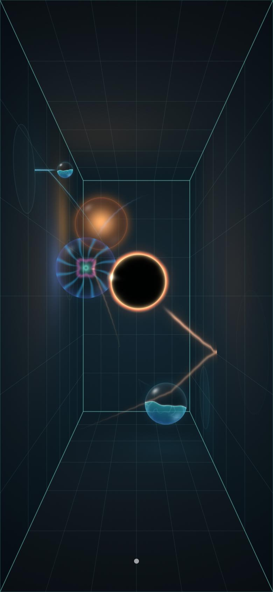
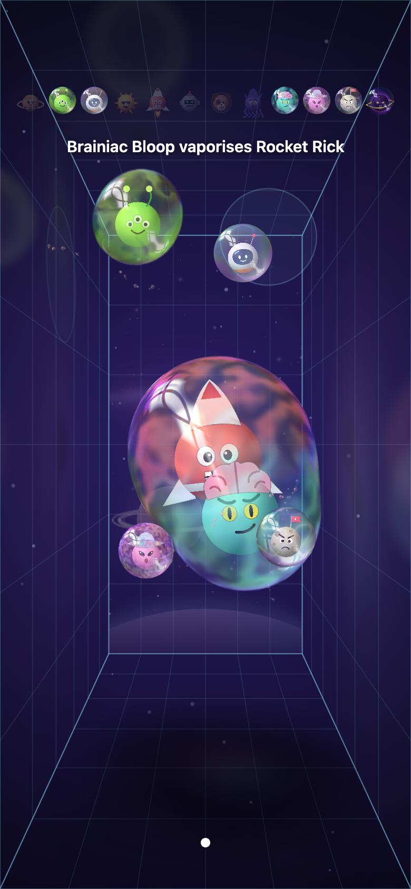
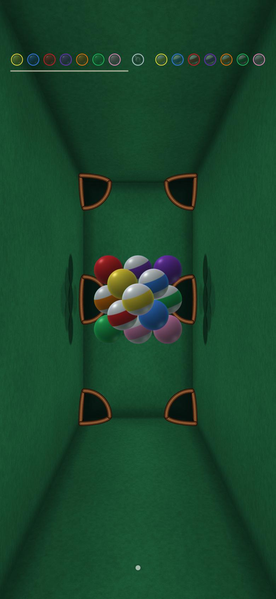
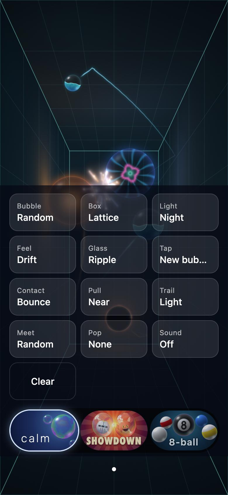
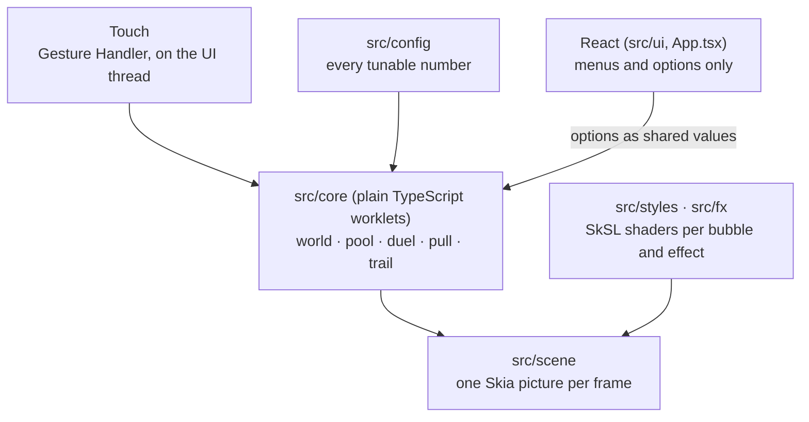

# Bubble Box

[](https://github.com/nwangemann/bubble-box/actions/workflows/check.yml)

A calm physics toy for iPhone. Hold the screen to grow a bubble, release to send it into a box whose near face is the glass, and watch it drift, bounce and come back. Built with Expo, React Native and Skia, with hand-written physics and shaders.

**Try it in a browser: [nwangemann.github.io/bubble-box](https://nwangemann.github.io/bubble-box/)**, best on a phone. It is the web preview: no haptics, sound or Glass ripples there.

<p>
  
  
  
  
</p>

## What it does

- **The calm room.** Every finger grows its own bubble. A longer hold launches harder, a swipe steers, a curved swipe spins. Bubbles squash on the walls, ripple the glass, pull on each other, can merge, and drift with the phone's tilt. A quick two-finger swipe pops what it crosses.
- **Twelve bubble styles, nine boxes, five physics feels**, plus trails, meeting and pop effects, and a custom bubble maker. Every option previews live in the menu; Random mixes them.
- **Showdown.** Up to 24 cartoon entrants from six themed casts fight in a see-through arena. Bubbles that meet either pop or coalesce, drawn as one ray-marched liquid surface. Tap one to root for it.
- **8-ball.** Pool in 3D, played through the glass: exact ball contacts, solids and stripes under WPA-based rules, and a computer opponent.
- **Quiet by design.** One dot is the only permanent control. Sound is optional synthesised tones that follow the silent switch. Reduce Motion is honoured throughout.

## Stack

Expo SDK 58, React Native 0.88 (New Architecture), React Native Skia for all drawing (SkSL shaders), Reanimated worklets for the frame loop, Gesture Handler for touch, `expo-audio` and `expo-haptics`. TypeScript throughout, Jest for tests, ESLint and Prettier. No physics or 3D engine.

## Architecture



Touch, physics and drawing all run on the UI thread, so there is no bridge between a finger and the bubble under it. React renders only when an option changes. `src/core` imports no React, Skia or Expo, so the physics and game rules are plain functions with unit tests. Details in [docs/architecture.md](docs/architecture.md).

## What's interesting

- **Hand-written physics** ([ADR 1](docs/adr/0001-stack.md)). Spheres in a box need only plane and sphere contacts, so the solver is a set of plain functions in `src/core`, run in fixed 1/120 s steps: the same motion at 60 and 120 Hz. Squash, merging, pull between bubbles and the push of a pop are all part of it.
- **3D from 2D shaders.** Each bubble is one rectangle with a fragment shader that computes its own normal, so films, glass and glow look spherical without meshes or a 3D renderer. Showdown merges are ray-marched per pixel as one smooth surface.
- **A rules engine and an opponent for 8-ball.** Exact contacts in `core/pool`, turns and fouls in `core/poolGame`, and a computer player that plays candidate shots out on a copy of the table, spread across frames so it never costs more than about 8 ms. The rules were chosen with simulated games ([docs/pool.md](docs/pool.md)).
- **Sound with no audio files** ([ADR 4](docs/adr/0004-sound.md)). Tones are synthesised from sine partials at launch, written as WAVs and pitched by playback rate, snapped to a pentatonic scale so overlapping tones agree.
- **A browser preview from the same code** ([ADR 3](docs/adr/0003-web-preview.md)). Skia runs on CanvasKit; only the start-up and storage differ. Useful for trying the app on a phone without a native build, and deployed as the [live demo](https://nwangemann.github.io/bubble-box/) ([ADR 5](docs/adr/0005-github-pages-demo.md)).

## Run and test

Needs Node 22.13+, 24.3+ or 26+ and, for native builds, Xcode with an iOS simulator.

```bash
npm install
npm run ios        # development build on the simulator
npm run check      # types, lint, formatting and 234 unit tests
npm run web:build && npm run web:serve   # browser preview on port 8098
```

More in [docs/running.md](docs/running.md).

## Status

Phase 1 is complete and tagged `v0.1.0`. The calm room, Showdown, 8-ball and sound are built and checked in tests, the iOS simulator and the browser preview. Feel, haptics, sound and frame time on a physical phone have not yet been judged; those checks are listed at the end of the [plan](docs/plan.md). The latest review is [docs/reviews/2026-11-25.md](docs/reviews/2026-11-25.md).

## Built with an AI agent

Bubble Box was written largely by an AI coding agent (Claude Code), steered by a person through written instructions, decision records and a plan of session-sized steps. [docs/ai-workflow.md](docs/ai-workflow.md) explains how, and what was verified by the agent versus left to a person.

## Docs

- [Vision](docs/vision.md): the interaction and principles
- [Plan](docs/plan.md): what is built, what is next, what needs a person
- [Architecture](docs/architecture.md) and [decisions](docs/adr)
- [Settings and defaults](docs/settings.md)
- [8-ball design and rules](docs/pool.md)
- [Adding a bubble, box, effect or arena](docs/extending.md)
- [Running](docs/running.md)

Agents start at [AGENTS.md](AGENTS.md).

## Licence

[MIT](LICENSE).
