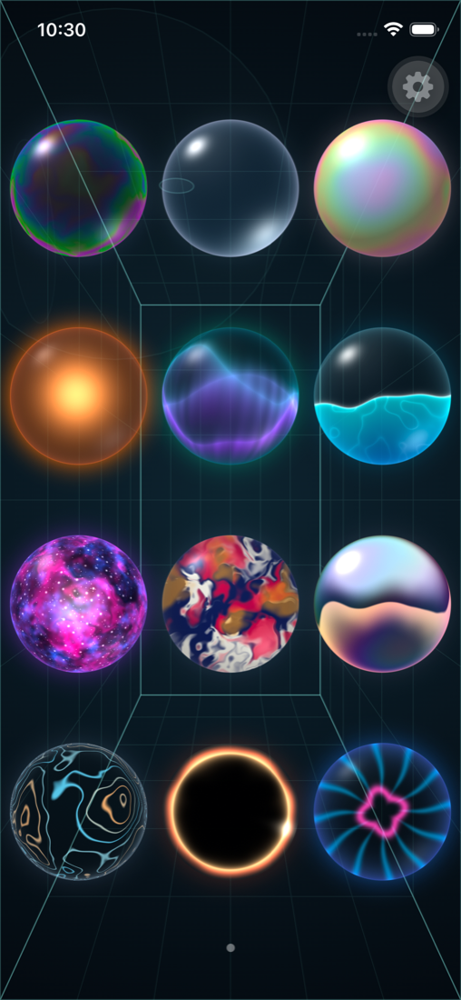

# Extending

Everything below appears in the tray and its previews, and joins Random, automatically. List new options in [settings](settings.md).

## Bubble style

1. Write SkSL in `src/styles/`: `half4 style(vec2 p, vec3 n, float rim)` (premultiplied) and `half4 halo()` (rgb, strength).
2. Use the helpers in `prelude.ts`: `fbm`, `film`, `spectrum`, `shine`, `skin`, `rimPow`.
3. Register it in `src/styles/index.ts`, with the `tint` it lends to effects.

Add `turn` to the rotation of anything on the surface so spin shows (`skin` already does). Leave highlights still: the light does not spin.

Keep to about 6 `fbm` calls per pixel: ten bubbles can overlap.

## Environment

Add to `src/config/environments.ts`. Give it a `day` palette. For a material, write `vec4 wall(vec2 t)` (colour, opacity) in `MATERIALS` in `src/scene/walls.ts`, honour `soft`, and name it in `wall`. `lit` is how well walls catch light from bubbles; a style casts light with `glow`.

## Meet and pop effects

1. Write `vec3 fx(vec2 p, float t)` in `src/fx/meet.ts` or `pop.ts`. `x` runs along the contact normal; use `hand()` and `spin` for twist, `blend()` for the two bubbles' colours.
2. Register it in `src/fx/index.ts`. `on` says which rows it appears in; a pop also needs `body`.

## Glass

Add to `src/config/glass.ts`. Wave speed and life are in `TUNING.glass`; ring spacing and decay are in `src/scene/glassFilter.ts`.

## Feel

Add to `src/config/feels.ts`. A new force is a new `Feel` field plus a line in `step` in `core/world.ts`.

Shaders compile once at start, so relaunch the app after editing one.
