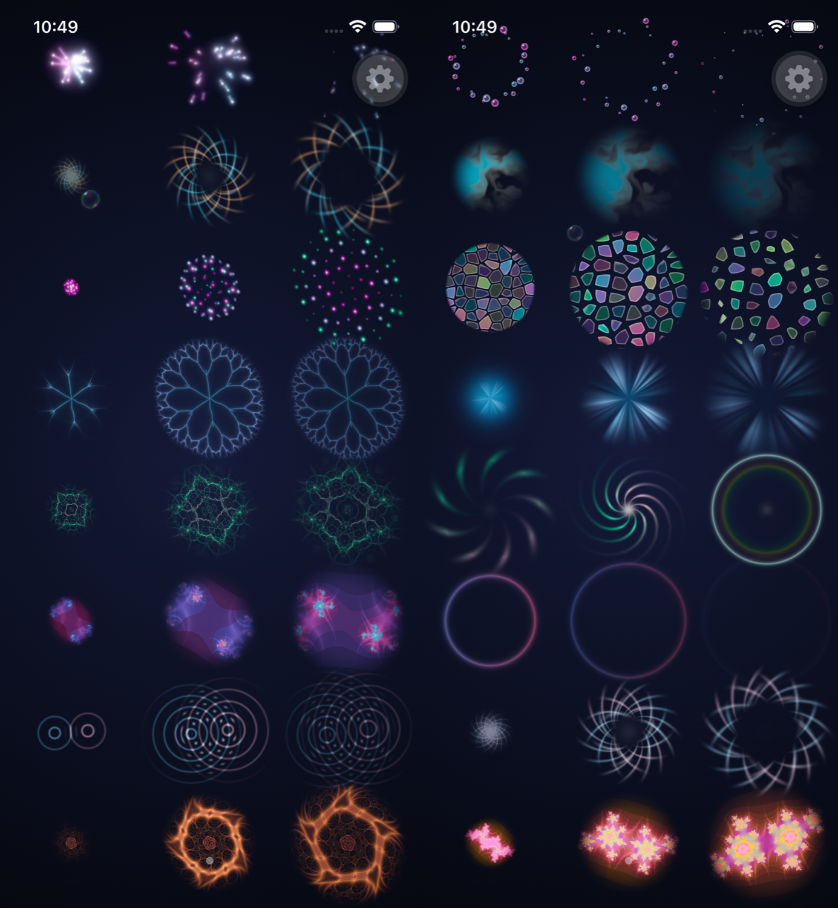

# Extending

Everything below appears in the menu and its previews, and joins Random, automatically. List new options in [settings](settings.md).

## Bubble style

1. Write SkSL in `src/styles/`: `half4 style(vec2 p, vec3 n, float rim)` (premultiplied) and `half4 halo()` (rgb, strength).
2. Use the helpers in `prelude.ts`: `fbm`, `film`, `spectrum`, `shine`, `skin`, `rimPow`.
3. Register it in `src/styles/index.ts`, with the `tint` it lends to effects.

Add `turn` to the rotation of anything on the surface so spin shows (`skin` already does). Leave highlights still: the light does not spin.

Keep to about 6 `fbm` calls per pixel: ten bubbles can overlap.

### Custom pattern

Add a branch to `motif` in `src/styles/custom.ts` and a name in the same place in `PATTERNS` in `src/config/custom.ts`: their orders must match.

## Environment

Add to `src/config/environments.ts`. Give it a `day` palette. For a material, write `vec4 wall(vec2 t)` (colour, opacity) in `MATERIALS` in `src/scene/walls.ts`, honour `soft`, and name it in `wall`. `lit` is how well walls catch light from bubbles; a style casts light with `glow`.

## Meet and pop effects

1. Write `vec3 fx(vec2 p, float t)` in `src/fx/meet.ts` or `pop.ts`. `x` runs along the contact normal; use `hand()` and `spin` for twist, `blend()` for the two bubbles' colours.
2. Register it in `src/fx/index.ts`. `on` says which settings it appears under; a pop also needs `body`.

## Glass

Add to `src/config/glass.ts`. Wave speed and life are in `TUNING.glass`; ring spacing and decay are in `src/scene/glassFilter.ts`.

## Contact

Add to `src/config/contacts.ts`. What merging does is `startMerge` and `sink` in `core/world.ts`.

## Pull

Add to `src/config/pulls.ts`. How it acts, and tires, is `attract` in `core/pull.ts`.

## Trail

Add to `src/config/trails.ts`, then write `vec3 trail(float v, float k, float born)` for it in `src/scene/trails.ts`. Spacing and tapering are `TUNING.trail`.

## Showdown theme

Write a `Theme` in `src/showdown/` and register it in `index.ts`. A cast is twelve; `npm test` fails if two share a name, colours, face or hat. Draw a `Fighter` on a ball of radius 1 with the helpers in `shapes.ts` and `parts.ts`, staying within 2.2. Its box is the core Lattice in its `backdrop` and `ink`; keep it see-through. Place its `mural` from `horizon` up, so it fits any screen; it shows faintly on the back wall. Paint it with `scenery.ts` in washes, light and mist, with no outlines. A title for an unusual win is an entry in `src/config/feats.ts` and its test in `src/core/feats.ts`. A new rule is an entry in `src/config/rules.ts`.

## Feel

Add to `src/config/feels.ts`. A new force is a new `Feel` field plus a line in `step` in `core/world.ts`.

Shaders compile once at start, so relaunch the app after editing one.
